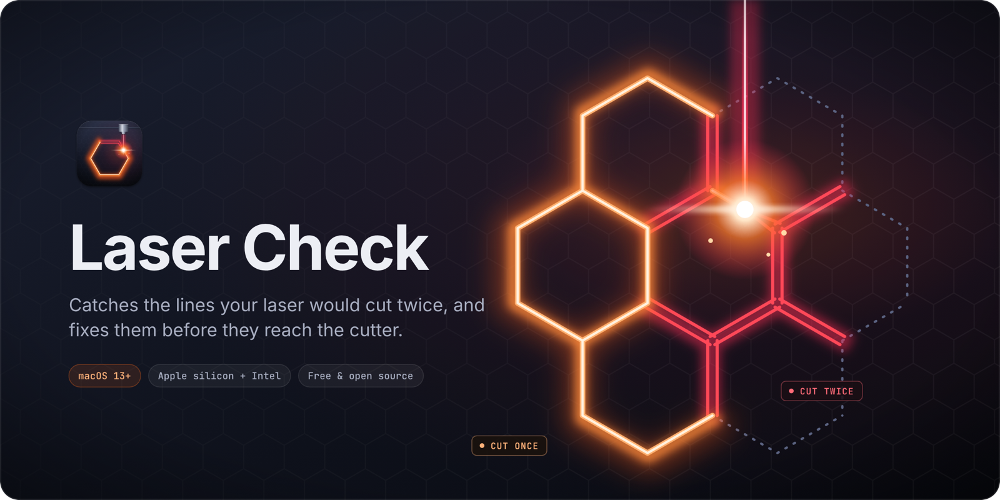
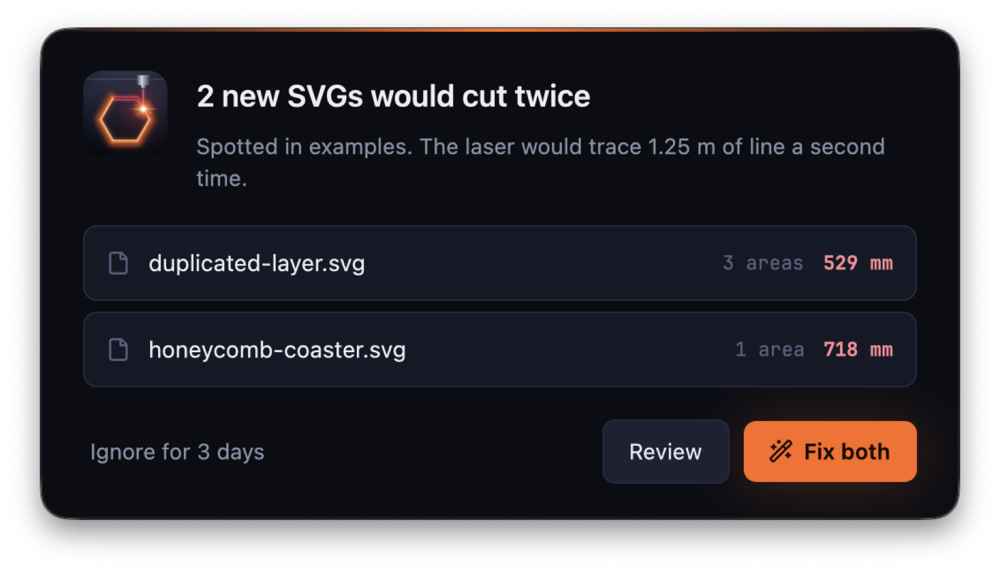
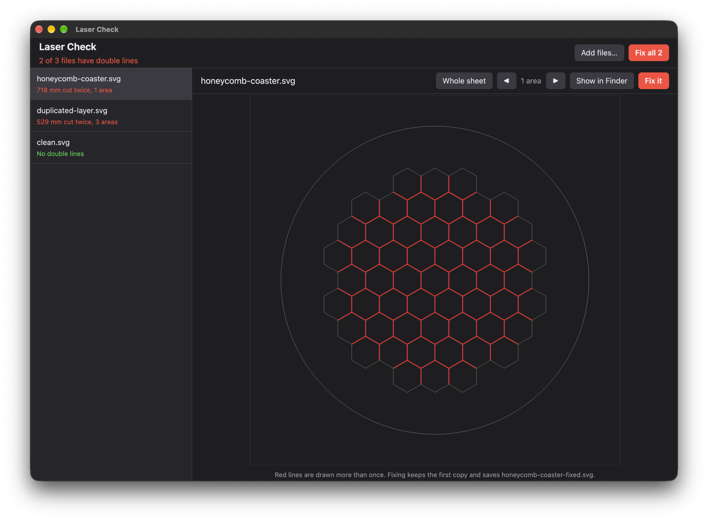
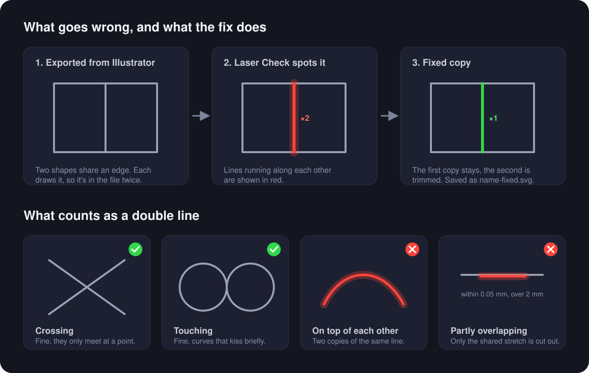

<p align="center">
  
</p>

<p align="center">
  <a href="https://github.com/DuffleOne/laser-svg-check/releases/latest"></a>
  <a href="https://github.com/DuffleOne/laser-svg-check/actions/workflows/ci.yml"></a>
  
  
  <a href="LICENSE"></a>
</p>

SVGs exported from Illustrator often have lines stacked on top of each other: shapes that share an edge, a layer that got duplicated, a stroke that was outlined twice. A laser cutter doesn't know they're the same line, so it cuts them two or three times. That burns the edges, wastes time and can cut right through things you meant to keep.

Laser Check sits quietly in the background, looks at every SVG that lands in your Downloads (from AirDrop, iMessage, a browser, anywhere), and pops up an alert the moment it finds doubled lines. One click shows you exactly where they are; another writes a fixed copy where every line is cut once.

<p align="center">
  <a href="https://github.com/DuffleOne/laser-svg-check/releases/latest"></a>
  <br>
  <sub>Free and open source · Apple silicon and Intel · macOS 13 or later</sub>
</p>

<p align="center">
  
</p>

<p align="center">
  
</p>

## Contents

- [Features](#features)
- [Install](#install)
- [Using it](#using-it)
- [How it decides](#how-it-decides)
- [Settings](#settings)
- [Command line](#command-line)
- [Troubleshooting](#troubleshooting)
- [Uninstall](#uninstall)
- [Building from source](#building-from-source)
- [Contributing](#contributing)
- [More docs](#more-docs)

## Features

- **Watches folders for you.** New SVGs in `~/Downloads` (or any folders you choose) are checked within a couple of seconds of arriving. Files still being written are left alone until they settle.
- **An alert you won't miss.** A floating window with a sound, listing each file, how many areas and how much line would be cut twice. Fix them there and then, or review first.
- **Checked fixes.** After fixing, every fixed copy is checked against its original: no line may go missing and nothing may still be doubled. Only then is it marked **verified**.
- **See exactly what's wrong.** Every problem area gets a numbered marker on the sheet, with its length in an inspector alongside. Click a number or press <kbd>↓</kbd> to zoom in on it, and flip between **Original** and **After fix**.
- **Safe fixes.** The fix keeps the first copy of every line and trims the rest, joining paths back up where it can. It writes `name-fixed.svg` next to the original and never touches the original. Everything it didn't need to change, from layers and ids to colours, text and images, is copied byte for byte.
- **Review a batch.** Open the app and drop in SVGs, a selection, or whole folders. Fix them one at a time or all at once.
- **Doesn't nag.** Files are remembered by content hash. Clean files are never checked again; a file you've already been warned about stays quiet for 3 days. The app's own fixed copies are never flagged.
- **Light on your Mac.** The watcher uses about 3 MB of memory and no CPU while it waits. The heavier window only opens when there's something to show.
- **Fast.** A 1.6 MB lace pattern with 70,000 curve segments takes about 60 ms.

## Install

### Download

1. Download `Laser-Check-<version>.dmg` from the [latest release](https://github.com/DuffleOne/laser-svg-check/releases/latest) and open it.
2. Drag **Laser Check** into **Applications**.
3. Open Laser Check from Applications. That starts the watcher, now and at every login.
4. The first time the watcher looks in Downloads, macOS asks for permission. Click **Allow**.

The app is signed and notarised by Apple. The build is universal, so it runs natively on Apple silicon and Intel Macs with macOS 13 or later.

If you only want the app and not the background watcher, set `start_at_login = false` in the [settings](#settings).

### From source

See [Building from source](#building-from-source).

## Using it

### When an alert pops up

| Button | What it does |
| --- | --- |
| **Fix it** / **Fix both** / **Fix all** | Writes `name-fixed.svg` next to each file, then checks each fixed copy. The alert turns green and lists them, marked **verified** once they pass. |
| **Review** | Opens the review window so you can see the problems first. |
| **Ignore for 3 days** | Closes the alert. You won't hear about these exact files again until then (the number follows `rewarn_days`). |

After fixing, **Show me** opens the review window and **Show in Finder** points at the fixed copies.

### The review window

Open **Laser Check** from Applications (or Spotlight) to get the review window. Then:

- drop SVGs or folders anywhere in the window,
- click **Add files…** (or press <kbd>⌘</kbd><kbd>O</kbd>), or
- drop files onto the app icon in the Dock, or choose **Open With → Laser Check** in Finder.

Folders are searched for SVGs, including folders inside them. The sidebar sorts files into **To fix**, **Fixed** and **Clean**. A `name-fixed.svg` that sits next to its original is shown under it rather than as a file of its own.

Pick a file to see the whole sheet with a numbered marker on every problem area. Doubled lines are usually far too small to see at that size, so:

- click a number to zoom to that area, or use <kbd>↑</kbd> <kbd>↓</kbd> to step through them,
- the inspector on the right lists every area with its length, and shows the selected one up close,
- **Original** / **After fix** switches between the file as it is and the fixed copy,
- **Fix this file** (<kbd>⌘</kbd><kbd>↩</kbd>) fixes the file you're looking at, and **Fix all** does every file in **To fix**.

## How it decides

<p align="center">
  
</p>

Every path, polygon, polyline, line, rect, circle and ellipse is read with its transforms applied and flattened into short straight pieces. Nearby pieces are compared, and two lines count as doubled where they run in the same direction (either way round), within **0.05 mm** of each other, for at least **2 mm** measured along the path.

That means lines that cross, curves that only touch for a moment, and the two sides of a sharp point are all fine. Shared edges, duplicated layers, stray fragments drawn twice, and paths that double back on themselves are caught. Shapes with no stroke and no fill are ignored entirely, since laser software doesn't cut them.

The fix goes through the file in drawing order and keeps whichever copy comes first. Later copies have just the doubled stretch cut out, so a path that is only partly on top of another keeps the rest of its length. If nothing is left of an element, it's removed.

There's more detail, including the edge cases, in [docs/how-it-works.md](docs/how-it-works.md).

## Settings

Settings live in `~/.config/laser-check/config.toml`, which is created with the defaults the first time Laser Check runs.

```toml
watch_dirs = ["~/Downloads"]   # folders to watch (not their subfolders)
rewarn_days = 3.0              # stay quiet about a file you've been warned about for this long
tolerance_mm = 0.05            # lines closer than this count as on top of each other
min_overlap_mm = 2.0           # ignore doubled stretches shorter than this
alert_sound = "Sosumi"         # any name from /System/Library/Sounds, or "" for silence
start_at_login = true          # run the watcher at login; opening the app applies this
```

Thresholds and the sound are read again for every check. After changing `watch_dirs`, restart the watcher:

```sh
launchctl kickstart -k gui/$(id -u)/one.duffle.laser-check
```

## Command line

The app's binary works on its own too. It's at `/Applications/Laser Check.app/Contents/MacOS/laser-check`; add an alias if you use it a lot.

```sh
laser-check check ~/Desktop/designs          # list files with doubled lines (exits 1 if any)
laser-check fix part.svg other.svg           # write part-fixed.svg and other-fixed.svg
laser-check verify part.svg part-fixed.svg   # confirm the fix kept every line
laser-check preview part.svg part.png        # render the red highlights to a PNG
laser-check preview part.svg zoom.png --area 2 --light
laser-check uninstall                        # stop the watcher and remove its login agent
laser-check help
```

## Troubleshooting

**Nothing happens when I AirDrop an SVG.** Check the watcher is running and has access to Downloads:

```sh
launchctl print gui/$(id -u)/one.duffle.laser-check | grep state
tail ~/Library/Logs/laser-check.log
```

If the log says it can't read the folder, open **System Settings → Privacy & Security → Files and Folders** and turn on **Downloads** for `laser-check`. If you've already been warned about that exact file in the last 3 days, it's skipped on purpose.

**macOS asks about Downloads again after an update.** Builds from source are signed ad hoc, which ties the permission to the exact build, so each new one asks once more.

**A file is flagged but I can't see anything wrong.** Open it in the review window and step through the areas with <kbd>↓</kbd>. Doubled lines are often tiny fragments a few millimetres long, sitting on top of each other in an otherwise empty part of the sheet.

**I want it stricter or looser.** Lower `min_overlap_mm` to catch shorter doubled stretches, or raise `tolerance_mm` if your copies are offset slightly rather than exactly on top of each other.

## Uninstall

Stop the watcher, then drag Laser Check from Applications to the Bin:

```sh
"/Applications/Laser Check.app/Contents/MacOS/laser-check" uninstall
```

If you installed from source, `scripts/install.sh --uninstall` does both. Your settings (`~/.config/laser-check`) and file history (`~/Library/Application Support/laser-check`) are left in place; delete them too if you want a clean slate.

## Building from source

You need Rust 1.88 or later and the Xcode command line tools. You don't need the full Xcode or its Metal toolchain.

```sh
brew install rustup && rustup default stable
git clone https://github.com/DuffleOne/laser-svg-check.git
cd laser-svg-check
scripts/install.sh    # build, install to ~/Applications, start the watcher
```

`scripts/package.sh` builds the same universal disk image the releases ship, into `dist/`.

## Contributing

Bug reports with an SVG attached are the most useful thing you can send, especially files it gets wrong. Code, docs and examples from other design tools are all welcome too. Start with [CONTRIBUTING.md](CONTRIBUTING.md).

## More docs

- [How it works](docs/how-it-works.md): the detection and fixing algorithm in detail.
- [Development](docs/development.md): project layout, running it locally, tests, and gpui notes.
- [Releasing](docs/releasing.md): cutting a new version.
- [Changelog](CHANGELOG.md)

## Licence

[MIT](LICENSE). The UI is built with [gpui](https://gpui.rs), the framework behind the Zed editor. Icons are from [Lucide](https://lucide.dev) (ISC), and numbers are set in [JetBrains Mono](https://www.jetbrains.com/lp/mono/), bundled under the [SIL Open Font Licence](assets/fonts/OFL.txt).
